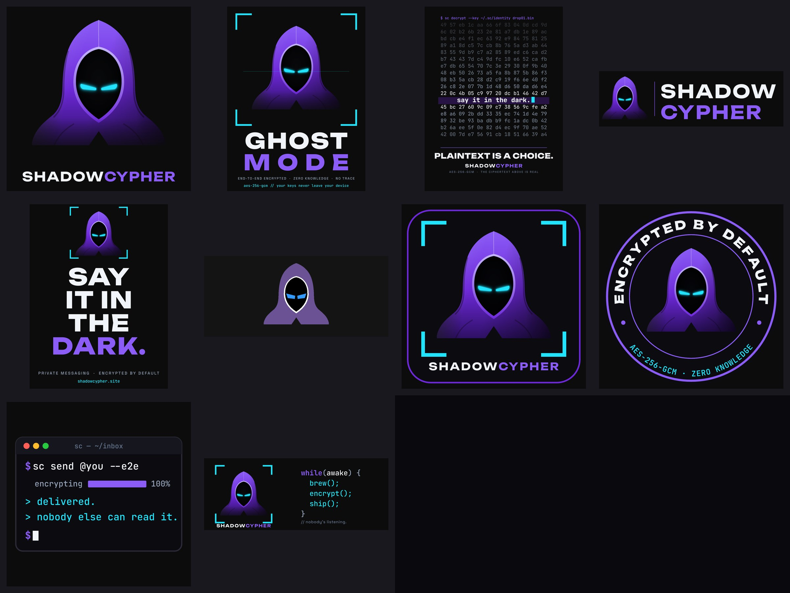

# ShadowCypher Drop 01

Eight print-ready pieces, a live shop page (`www/shop.html`) and a Printful + Stripe
order pipeline in the API (`backend/api/src/shop.ts`). Nothing is public or paid
until the Printful store is set up and the secrets below are added.



## Rebuild the artwork

```bash
pip install resvg-py uharfbuzz fonttools pillow numpy cryptography
python3 merch/drop01/build.py
```

Writes `src/` (SVG, text outlined), `print/` (300 DPI PNGs for Printful),
`preview/` and the web copies in `www/shop/drop01/`. Fonts are in `fonts/` (all SIL OFL:
Unbounded, Space Grotesk, JetBrains Mono). `print-files.json` lists every file,
its product, placement and physical size.

Brand: violet `#8b5cf6` / `#6d28d9` from the site, signal cyan `#22e3ff`, ice
`#f1f5f9`, on Printful black `#0c0c0c`. Glows are baked against the garment colour
and then knocked out, so the DTG files are almost entirely opaque ink (no grey
haze from semi-transparent pixels on black shirts).

## The line-up

| Product | Printful blank (product id) | Black variant ids | Print files | Base cost* | Proposed retail |
|---|---|---|---|---|---|
| Ghost Mode Tee | Bella+Canvas 3001 (71) | XS 9527, S 4016, M 4017, L 4018, XL 4019, 2XL 4020, 3XL 5295 | `ghost-mode-tee_left-chest.png` front, `ghost-mode-tee_back.png` back | $11.92 + back placement | $34 (2XL $36, 3XL $38) |
| Plaintext Tee | Bella+Canvas 3001 (71) | same as above | `plaintext-tee_front.png` front | $11.92 | $30 (2XL $32, 3XL $34) |
| Say It In The Dark Hoodie | Gildan 18500 (146) | S 5530, M 5531, L 5532, XL 5533, 2XL 5534, 3XL 5535 | `dark-hoodie_chest.png` front, `dark-hoodie_back.png` back | $22.63 + back placement | $62 (2XL $64, 3XL $66) |
| Hood Dad Hat | Yupoong 6245CM (206) | Black 7854 | `hood-dad-hat_embroidery-front.png` embroidery front | $14.94 | $30 |
| Ghost Mode Sticker | Kiss-Cut Stickers (358) | 4″×4″ 10164 | `sticker_ghost-mode.png` | $2.50 | $5 |
| Encrypted Seal Sticker | Kiss-Cut Stickers (358) | 4″×4″ 10164 | `sticker_encrypted-seal.png` | $2.50 | $5 |
| Terminal Sticker | Kiss-Cut Stickers (358) | 4″×4″ 10164 | `sticker_terminal.png` | $2.50 | $5 |
| while(awake) Mug | Black Glossy Mug (300) | 11 oz 9323 | `mug_wrap.png` | $8.11 | $20 |

\* Printful catalogue prices read on 2026-10-31, before shipping and before any extra
placement fee. Check the final cost on Printful's pricing step when creating each product.

Hat embroidery uses Printful's own thread colours only: 1832 Purple `#6B5294`,
1801 White `#FFFFFF`, 1695 Aqua/Teal `#3399FF`, 1800 Black `#000000` (flat, no puff).

The Plaintext Tee grid is a real AES-256-GCM ciphertext (key `0x5c`×32, nonce
`0x0b`×12, AAD `sc-drop-01`) of filler text plus the line printed in the middle.

## Going live (needs a yes before any of this)

1. Create a free Printful account and a **Manual order / API** store.
2. For each row above, create the product in Printful with the listed blank, black
   colour, sizes and print files (placement notes are in `print-files.json`), and set
   the retail price. Printful generates the photo mockups the shop shows.
3. Create a Printful private token with the *Orders* and *Store products* scopes.
4. Add the secrets and point the existing Stripe webhook at the shop events:

   ```bash
   cd backend/api
   wrangler secret put PRINTFUL_API_TOKEN
   # optional vars in wrangler.toml [vars]:
   #   PRINTFUL_STORE_ID (account-level tokens only)
   #   SHOP_AUTO_CONFIRM = "false"   # orders arrive as Printful drafts until flipped
   #   SHOP_SHIPPING_CENTS = "699"   SHOP_FREE_SHIPPING_CENTS = "7500"
   npm run deploy
   ```

   In Stripe, the webhook endpoint `https://api.shadowcypher.site/v1/billing/webhook`
   must also send `checkout.session.completed` (already on for subscriptions) and
   `checkout.session.async_payment_succeeded`.
5. Test with Stripe test keys first: buy one sticker, confirm a **draft** order appears
   in Printful with the right address, then switch to live keys.
6. Link `shop.html` from the site nav and remove `noindex` from its `<head>`.

## How an order flows

`shop.html` → `GET /v1/shop/products` (catalogue read from Printful, cached 5 min) →
`POST /v1/shop/checkout` (prices re-read server-side, Stripe Checkout in payment mode,
flat shipping, free over $75) → Stripe webhook `checkout.session.completed`
(`metadata.kind = shop`) → `POST printful /orders` with the session's shipping address.
The Printful `external_id` is a hash of the Stripe session id, so webhook retries never
create a second order. Subscription billing is untouched: shop sessions return before
the subscription code runs.
